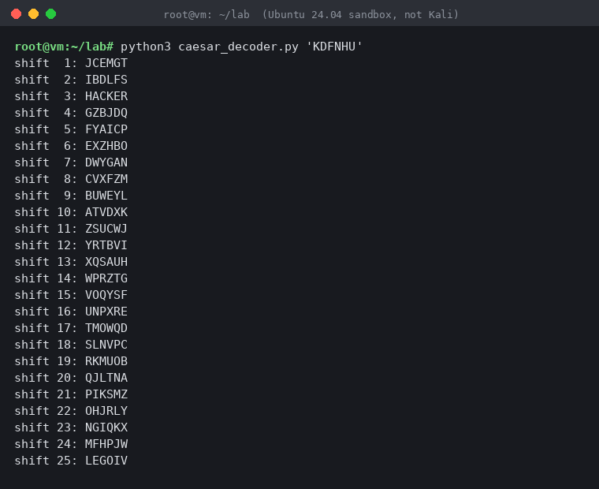

# S01 Foundations: Day 1 Homework

**Name:** [your name] · **Cohort:** DFCS · **Submitted:** by Tuesday 27 October 2026, 23:59

Contents: Task A (compulsory), Task B3 (Caesar decoder) and Task B5 (MITM case study). Neither B task needs a virtual machine: B3 is a Python script that runs on any computer with Python 3, and B5 is a researched case study with cited sources.

---

## Task A: Malware types and examples

| Type | Definition in my own words | Named example + year | How it spread | Primary impact |
|---|---|---|---|---|
| **Virus** | Code that attaches itself to a legitimate file and only runs, and so only spreads, when someone runs that host file. | **CIH / "Chernobyl"**, 1998 | Infected Windows executables passed around on disks, downloads and pirated software | Overwrote data on the hard disk and, on some motherboards, tried to corrupt the BIOS chip so the machine would not boot |
| **Worm** | Malware that copies itself across a network on its own, with no user action, by exploiting a flaw in a service. | **Morris worm**, 1988 | Exploited a debug feature in `sendmail`, a bug in `fingerd`, and weak passwords on Unix systems | A flaw in its re-infection logic meant machines were hit repeatedly, so thousands of systems became too slow to use; this is the first large DoS caused by self-replicating code |
| **Trojan** | Software that looks useful or harmless but carries a hidden malicious function; the victim installs it themselves. | **Zeus (Zbot)**, first seen 2007 | Phishing attachments and drive-by downloads | Banking trojan: injected into the victim's browser to steal online-banking logins and alter what the user saw, a browser-side form of MITM |
| **Ransomware** | Malware that denies access to your own data, usually by encrypting it, then sells access back. It attacks **Availability** from the CIA triad. | **WannaCry**, 2017 | Used the EternalBlue SMBv1 exploit to jump between unpatched Windows machines (so it behaved like a worm too) | Encrypted files and demanded Bitcoin; disrupted hospitals in England's NHS, forcing appointments to be cancelled |
| **Spyware** | Malware whose purpose is quiet observation: reading messages, recording audio, tracking location. | **Pegasus (NSO Group)**, publicly identified 2016 | First documented case used a link in an SMS sent to a UAE human-rights activist; later versions needed no click at all | Full access to the phone's messages, microphone, camera and location, aimed at journalists, activists and officials |
| **Adware** | Software that forces advertising on you, usually by modifying the browser or injecting content into pages. | **Superfish**, 2015 (pre-installed on Lenovo laptops) | Shipped by the manufacturer on consumer laptops, so no infection step at all | Injected ads into web pages, and installed a root certificate whose private key was the same on every laptop, so anyone could run a MITM attack on HTTPS for those users |
| **Rootkit** | Code that hides the presence of other software (files, processes, registry keys) from the operating system and the user. | **Sony BMG XCP copy protection**, 2005 | Installed silently when a protected music CD was played on a Windows PC | Hid its own files from the user, which also gave other malware a hiding place, and Sony had to recall the CDs |
| **Keylogger** | Malware that records what is typed (and often the clipboard and saved browser passwords) and sends it to the attacker. | **Agent Tesla**, first seen 2014 | Sold cheaply as a commercial tool and spread through phishing emails with Office or archive attachments | Stole credentials and sent them out by email, FTP or HTTP, giving attackers a way into mailboxes and business accounts |
| **Botnet agent** | A small program that turns a device into a remotely controlled "bot", which the operator rents or uses for attacks such as DDoS. | **Mirai**, 2016 | Scanned the internet for IoT devices (cameras, home routers) using factory-default Telnet logins | Its network of hijacked devices flooded the DNS provider Dyn in October 2016, taking down many large websites for hours |
| **Fileless / living-off-the-land** | Malware that avoids dropping its own executable and instead abuses tools already on the system (PowerShell, WMI, `certutil`, `bitsadmin`) so there is little for antivirus to scan. | **Astaroth campaign**, 2019 | Phishing email carrying a shortcut (`.lnk`) file that launched a chain of built-in Windows tools | Credential and data theft that ran mostly inside trusted system processes, which made it hard to detect |
| **Logic bomb** | Code that sits dormant until a condition is met (a date, a missing username, a counter), then does damage. | **Omega Engineering sabotage**, 1996 | It did not spread: a systems administrator planted it on the company's own server before leaving | Deleted the production software that ran the company's manufacturing, reported at around $10 million in losses; the insider was later convicted |
| **Bootkit** | A rootkit that infects the boot process (the MBR or boot sector) so it loads before the operating system and before security tools. | **TDL4 / TDSS**, 2010 | Bundled with pirated software and delivered by criminal "pay-per-install" affiliates | Survived reinstalling Windows over the top, hid itself, and enrolled infected machines into a botnet |

*Note for the reader: the Sony, Superfish and Zeus rows each connect back to Day 1 topics (rootkit hiding, MITM via fake or shared CA, browser-side interception).*

### Which type is most dangerous for a Pakistani SME?

Ransomware is the most dangerous, because a small business usually has one flat network, few staff who can respond to an incident, and backups that are either missing, untested, or stored on the same network that gets encrypted. The damage lands on Availability, which is the property an SME depends on most: if invoicing, stock and customer records are locked for a week, the business loses revenue every day with no cash buffer to absorb it. It is also the type most likely to arrive through the cheapest route, a phishing email or an unpatched, unlicensed Windows machine that can no longer receive security updates, so the defences that matter (offline backups, patching, MFA, staff reporting suspicious mail) are cheap compared with the cost of one incident.

---

## Task B3: Caesar cipher decoder

`caesar_decoder.py` (runs on any OS with Python 3) takes a shifted string and prints all 25 possible decryptions. It keeps case and leaves spaces and punctuation unchanged.

```python
#!/usr/bin/env python3
"""Caesar brute-forcer: print all 25 possible decryptions of a shifted string."""
import sys

def shift(text, k):
    out = []
    for ch in text:
        if ch.isupper():
            out.append(chr((ord(ch) - 65 - k) % 26 + 65))
        elif ch.islower():
            out.append(chr((ord(ch) - 97 - k) % 26 + 97))
        else:
            out.append(ch)          # leave spaces/punctuation alone
    return "".join(out)

def main():
    if len(sys.argv) < 2:
        sys.exit("usage: python3 caesar_decoder.py 'KDFNHU'")
    ciphertext = " ".join(sys.argv[1:])
    for k in range(1, 26):
        print(f"shift {k:2d}: {shift(ciphertext, k)}")

if __name__ == "__main__":
    main()
```

**Sample run** (the `KDFNHU` string from class):

```
$ python3 caesar_decoder.py 'KDFNHU'
shift  1: JCEMGT
shift  2: IBDLFS
shift  3: HACKER
shift  4: GZBJDQ
shift  5: FYAICP
shift  6: EXZHBO
shift  7: DWYGAN
shift  8: CVXFZM
shift  9: BUWEYL
shift 10: ATVDXK
shift 11: ZSUCWJ
shift 12: YRTBVI
shift 13: XQSAUH
shift 14: WPRZTG
shift 15: VOQYSF
shift 16: UNPXRE
shift 17: TMOWQD
shift 18: SLNVPC
shift 19: RKMUOB
shift 20: QJLTNA
shift 21: PIKSMZ
shift 22: OHJRLY
shift 23: NGIQKX
shift 24: MFHPJW
shift 25: LEGOIV
```



Only one line is readable English: **shift 3 → `HACKER`**, so the key was 3, matching the +3 shift from class.

**Why 25 tries is not security:** a cipher with only 25 possible keys can be fully searched in a fraction of a millisecond, and a person can spot the one readable line by eye, so secrecy depends entirely on nobody bothering to try.

---

## Task B5: MITM case study, DigiNotar (2011)

**Who:** the victims were users of Gmail and other Google services, mostly in Iran (the Fox-IT investigation counted roughly 300,000 unique requesting IP addresses, over 99% of them from Iran), and the company whose systems were broken into, DigiNotar, a Dutch certificate authority (CA). Fox-IT's final report says several independent traces point to an attacker located in Iran, though nobody was charged ([Threatpost summary of the Fox-IT final report](https://threatpost.com/final-report-diginotar-hack-shows-total-compromise-ca-servers-103112)).

**How it worked:**

1. An intruder got into DigiNotar's certificate-issuing servers; Fox-IT put the initial compromise in June 2011 ([Fox-IT report, Dutch government publication](https://zoek.officielebekendmakingen.nl/blg-191225.pdf)).
2. From there the attacker had DigiNotar's systems issue 531 fraudulent certificates ([CIO Australia](https://www2.cio.com.au/article/399773/rogue_google_certificate_used_by_300_000_iranian_ips/)), among them a wildcard certificate for `*.google.com`, issued on 10 July ([Wikipedia: DigiNotar](https://en.wikipedia.org/wiki/DigiNotar)).
3. Every browser trusted DigiNotar, so it also trusted that certificate. Someone in Iran, positioned on the network path, presented it to users trying to reach Google, and the browser showed a normal padlock. Fox-IT's final report says the certificate was abused for weeks ([Fox-IT report](https://zoek.officielebekendmakingen.nl/blg-191225.pdf)). This is the "TLS interception with a fake CA" row of the MITM table in Section 1.2 of the Day 1 handout.
4. It came to light on 28 August 2011, when Google's Chrome flagged the certificate because Google domains were *pinned* in the browser; the certificate had appeared on Pastebin and Google received reports of attempted MITM attacks ([Wikipedia: DigiNotar](https://en.wikipedia.org/wiki/DigiNotar); [Computerworld](https://www.computerworld.com/?p=1434814)).

**What the attacker got:** the ability to read and modify the victims' encrypted Google traffic, including their Google login credentials ([Fox-IT report](https://zoek.officielebekendmakingen.nl/blg-191225.pdf)). The consequences for the CA were just as severe: browsers removed trust in DigiNotar, and the company was ultimately liquidated ([iTnews](https://www.itnews.com.au/news/diginotar-hack-details-revealed-by-dutch-govt-321870)).

**Timeline problem:** DigiNotar detected an intrusion on 19 July 2011 but did not publicly reveal it ([Wikipedia: DigiNotar](https://en.wikipedia.org/wiki/DigiNotar)), and the rogue Google certificate was not revoked until 29 August ([PCWorld](https://www.pcworld.com/article/482536/nearly_300000_iranian_ip_addresses_likely_compromised.html)). That is about six weeks between "we know someone is inside" and "the fake certificate stops working".

**Control that would have stopped or limited it:**

| Control | What it does here | Cost (my estimate) |
|---|---|---|
| **Immediate disclosure and revocation of every certificate issued during the intrusion window** | Ends the usable life of the rogue certificate as soon as the compromise is known, rather than six weeks later | Mostly staff time and a clear incident-response decision; very cheap compared with the outcome |
| **Certificate pinning (or later, Certificate Transparency monitoring) for high-value domains** | Lets the client reject a certificate that is valid but not the expected one; Chrome's pinning is what exposed this attack, but at the time it covered only Google domains | A configuration list maintained by the service owner; low cost, but it protects only the sites that adopt it |
| **Stronger isolation and monitoring of the CA signing systems** | Makes it much harder for an intruder to issue certificates at all | The highest cost of the three (separate network, hardware key storage, logging), but this is the core business of a CA |

**Conclusion:** the technical protocol (TLS) worked as designed; what failed was trust in one organisation plus slow response. As the handout says, the failure was organisational more than technical. The cheapest control that would have mattered most was acting immediately on the 19 July detection. The cost of not doing so was the end of the company.

*Sources checked 8 November 2026. Fox-IT's final report is the primary source; the news and encyclopaedia pages are secondary.*
